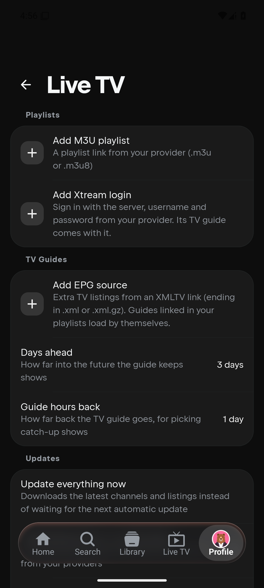
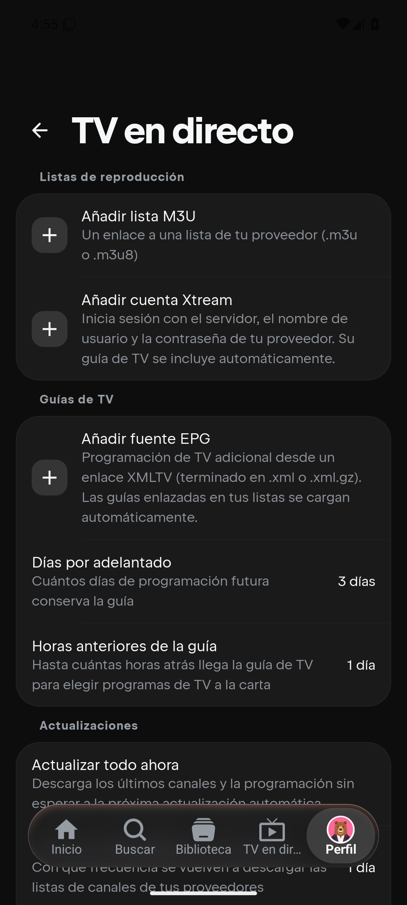
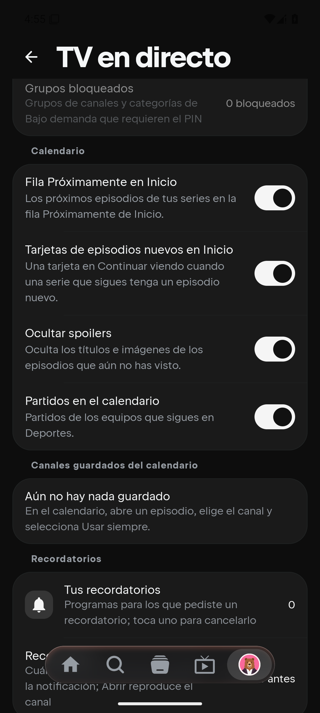

# Mobile IPTV settings localization

This verification belongs to `homelessbrian/NuvioPlusIPTV-Mobile`, based on
`1929eec6aedd0dfa46ed7dd8889ae9682d8f4856`. It does not verify the separate TV app.

## Resource coverage

Run from the repository root:

```sh
python3 ci/verification/iptv-settings-language/check_resources.py
```

The base had 403 Live TV strings and no Spanish Live TV translations. This change
adds Spanish coverage for all 486 current Live TV strings, two existing settings entry
labels, and seven plural resources, including the newly extracted settings text.
The checker reports **488 strings and seven plurals** and verifies complete key/type
coverage, duplicate keys, plural quantities, format argument indices and types,
nonempty text, Unicode replacement characters, and escaped newlines.

The settings text uses the existing Compose resources and app language selection.
The scope includes Calendar controls, durations, account expiry/counts, timezone
names, VOD sort labels, Game Alerts, Setup Sync controls and its dialogs.

## Scope and limits

- English remains the default fallback. This adds Spanish translations; other
  languages still fall back to English for missing Live TV keys.
- Provider/user names, URLs, credentials, timezone IDs, stored enum values and
  protocol labels retain their original values.
- Existing repository-generated progress/status messages and diagnostic error
  bodies are outside this static settings localization change and can remain English.
- The shared mobile Compose source is used by Android and iOS. Windows validation
  does not establish iOS build or device acceptance.
- No playback, guide loading, search, matching, account sync logic or settings
  defaults are changed.

## Android phone validation

Verified on 2026-11-12 using an Android 15 / API 35 x86_64 Pixel 6 phone emulator,
1080x2400 at 420 dpi, with touch controls. The isolated preview package was
`com.nuvio.livetv.mobile.localepreview`; its temporary build-ID override is excluded
from this change. Production app data was not used.

Both `:androidApp:assembleFullDebug` and `:androidApp:assembleFullDebugAndroidTest`
passed, using JDK 21, the full distribution, and the x86_64 build ABI.
The automated English smoke test passed: **1 test, 21.275 seconds**.

`com.nuvio.android.LiveTvSettingsLocaleTest` checks the real
phone settings content, Add M3U and VOD sort dialogs, Calendar and Setup Sync labels,
recording padding choices, saving across activity recreation, and restoration of
the original choice. It invokes accessible row/choice actions and restores the
original app language afterward.

Language switching was checked separately through the normal app UI and cold launches:

1. Open the app from its normal launcher, continue without an account, and create a
   local test profile with no playlists/accounts.
2. Open Profile (Settings) -> Live TV and verify the English labels and plural values.
3. Use Appearance -> App Language -> Spanish, force-stop only the preview package,
   and launch it again. Verify Spanish in the settings entry, page header, playlists,
   guide controls, Calendar controls and saved-channel instructions.
4. Open the Days ahead chooser using touch, select one day, reopen it and restore
   three days.
5. Select English through the same normal language picker, cold-launch again and
   verify English in Live TV settings. The preview was left in English and stopped.

The instrumented activity host did not reliably apply per-app locale changes and is
not used as evidence for language switching or Spanish rendering.

These captures show the full mobile app reached through normal navigation:





No physical phone, iOS device/build, provider login, playback or authenticated sync
acceptance is claimed by these checks.

Use a separate debug/preview application ID; never run this test against the
installed production app.
